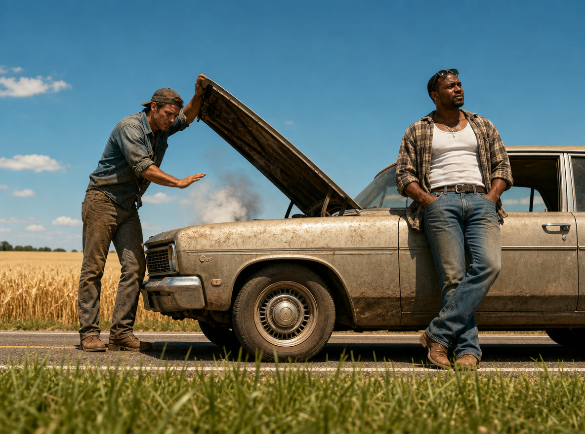
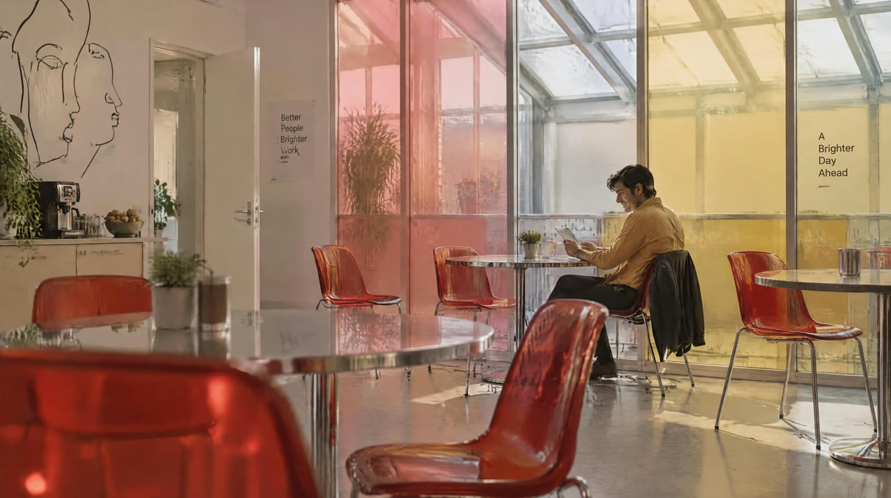

<p align="center">
  
</p>

<h1 align="center">Topview 3D Builder</h1>

<p align="center"><b>Let AI build your 3D scenes</b></p>

<p align="center">
  From an idea, to a 3D scene built by your agent, to a real animated video. Free, runs locally, no sign-up.
</p>

<p align="center">
  <a href="https://github.com/topviewai/topview-3d-builder/blob/main/LICENSE"></a>
  <a href="https://www.python.org"></a>
  <a href="https://nodejs.org"></a>
  
</p>

<p align="center">
  <a href="#quick-start">Quick Start</a> |
  <a href="#see-what-you-can-make">Examples</a> |
  <a href="https://www.topview.ai/academy/spatial-control#3-1-3d-builder-build-scenes-stage-action-and-move-the-camera">Tutorial</a> |
  <a href="https://www.topview.ai/3d-builder">3D Builder</a> |
  <a href="https://www.topview.ai">Topview.ai</a> |
  <a href="https://github.com/topviewai/topview-3d-builder/issues">Issues</a>
</p>

https://github.com/user-attachments/assets/ae8923ce-e03e-473c-8e75-941bcb945f9c

<p align="center"><sub>Build the scene, place the cameras, plan the camera move in Studio, then get the shot.</sub></p>

## Quick Start

**Recommended model: Qwen 3.8 Flash.** It costs about 1/150 of GPT 6 Astra and reaches a similar result. We recommend using it.

Works with **ChatGPT / Codex**, **Qoder**, **Claude Code**, **Cursor** and any agent with skills support. You need Python 3.11+, Node.js 20.6+, and either [uv](https://docs.astral.sh/uv/) or pipx.

**1. Install the plugin**

**ChatGPT / Codex**: open the plugin page in the app and install it from there.

[Install Topview 3D Builder in ChatGPT / Codex](https://chatgpt.com/plugins/plugin_asdk_app_6accab1016088191b19230b3c7ecaec4?open_in_app)

**Other agents (Qoder, Claude Code, Cursor, or any agent with skills support)**: send this to your agent.

```text
Install the Topview 3D Builder plugin from https://github.com/topviewai/topview-3d-builder for the agent I'm using (Qoder, Claude Code, Cursor or another agent with skills support). Follow the install steps in the README, then tell me when to restart.
```

<details>
<summary>What your agent will run</summary>

**Claude Code** (restart Claude Code afterwards)

```bash
claude plugin marketplace add https://github.com/topviewai/topview-3d-builder.git
claude plugin install topview-3d-builder@topview-3d-builder
```

**Cursor** (restart Cursor afterwards)

```bash
git clone https://github.com/topviewai/topview-3d-builder.git ~/.cursor/plugins/local/topview-3d-builder
```

**Any agent with skills support, including Qoder**

```bash
npx skills add https://github.com/topviewai/topview-3d-builder.git
```

Then pick `topview-3d-cli`. The first render downloads a browser component once; after that it is cached. For the CLI and project format, see the [CLI reference](https://github.com/topviewai/topview-3d-builder/blob/main/docs/topview-3d-cli.md).

</details>

**2. Start a new session and describe the scene you want**

> Build a scene: a character sits next to a box. Render a front view.

**3. Review the scene and keep refining**

Keep talking to your agent, or open Studio and adjust by hand. When you're happy, turn the 3D scene into a real animated video.

## What is Topview 3D Builder?

Topview 3D Builder is a **3D director's stage for AI video**. You describe the scene, and your agent builds it in 3D: who stands where, who faces what, what they hold, and where the camera sits. That 3D scene then guides the video model, so the staging comes from you instead of from luck.

It covers the whole path from **an idea, to a 3D scene, to a real animated video**. The 3D scene fixes blocking, scale and camera angles. Texture, lighting and performance come from the video model.

```
An idea  →  Agent builds the 3D scene  →  Auto-check and refine  →  Multi-camera render  →  Real animated video
```

Everything before the video runs on your machine, free, with no account and no upload.

## What problem does it solve?

If you make AI videos, you've probably hit this: text prompts can't describe space precisely, so you can't control where people stand or where the camera goes. Directing AI video ends up feeling like gambling. 3D Builder gives you control back.

| The problem | How 3D Builder solves it |
| --- | --- |
| 😵 **Blocking is a guess.** "Two people facing each other across a table" comes back side by side, clipping, or without the table. | 🎬 **Direct, don't gamble.** You place characters, poses, props and cameras, so blocking and facing are decided, not guessed. |
| 🎰 **Camera angles are a lottery.** You write a paragraph and get one random angle. | 🎥 **Design the camera move in advance.** Plan push-ins, pull-backs, rises, orbits and cuts on a timeline. |
| 🔁 **One tweak, full redo.** Move a character half a step and everything changes on regenerate. | ✏️ **Edit one thing, keep the rest.** The scene is a saved project. Move a character, change a pose or add a camera without starting over. |
| 💸 **Retries burn credits.** A usable shot can take a dozen attempts. | ✅ **Checked before you generate.** Floating or clipping characters, spacing and framing are measured automatically, so problems are caught early. |
| 🧩 **Shots don't match.** Character positions and space contradict each other from shot to shot. | 🎬 **One scene, many cameras.** Render several cameras from the same scene and characters and space stay consistent in every shot. |
| 📐 **Not everyone can storyboard.** No art skills means no way to show the staging in your head. | 💬 **Just describe it.** No 3D software to learn. Ask in plain language and your agent builds the scene. |

## How it works

1. **Describe the shot.** Tell your agent the scene you want, for example: *"Two people sit across a table, a woman is talking. Give me a front, an over-the-shoulder and a top-down shot."*
2. **The agent builds the 3D scene.** It uses built-in characters, poses and props, and places the cameras.
3. **Check and refine.** The scene is measured automatically. Keep talking to your agent, or open Studio and drag things around.
4. **Render and generate.** Render the cameras, plan the camera moves, then turn the 3D scene into a real animated video.
### Example

Each row shows the prompt, the 3D scene built from it, and the video generated from that scene: **the way you stage it in 3D is the way it gets shot.**

<table>
  <tr>
    <th width="28%" align="center">Input</th>
    <th width="36%" align="center">3D scene<br><sub>generated by 3D Builder</sub></th>
    <th width="36%" align="center">Generated video<br><sub>rendered by Topview.ai</sub></th>
  </tr>
  <tr>
    <td valign="top"><b>Reference image:</b><br><br><b>Prompt:</b> Build the 3D scene from the reference image.<br>0–3s: Pull back from the leaning man to show both men and the car.<br>3–5s: Over-the-shoulder push-in to the engine.<br>5–7s: Fixed first-person shot of the engine.</td>
    <td align="center"><video src="https://github.com/user-attachments/assets/26108771-b47f-4e14-ac65-605329030369" width="100%" controls muted playsinline></video></td>
    <td align="center"><video src="https://github.com/user-attachments/assets/78aaa908-a3bf-4d4e-a0a3-172aa460c76d" width="100%" controls muted playsinline></video></td>
  </tr>
  <tr>
    <td valign="top"><b>Reference image:</b><br><br><b>Prompt:</b> Build the 3D scene from the reference image.<br>0–2.5s: Wide shot, slow push-in.<br>2.5–5s: Medium shot, tracking sideways.<br>5–7s: Close-up of him reading.</td>
    <td align="center"><video src="https://github.com/user-attachments/assets/623c3610-0eb1-4f66-a1bf-ef1b28a2e360" width="100%" controls muted playsinline></video></td>
    <td align="center"><video src="https://github.com/user-attachments/assets/aca8255e-e22c-4e47-b55a-4cf614d067a2" width="100%" controls muted playsinline></video></td>
  </tr>
  <tr>
    <td valign="top"><b>Prompt:</b> A person stands beside a sports car in a showroom. In one continuous ten-second shot, the camera moves from a low angle by the front wheel to a frontal view of the person, then rises and moves around to reveal the car from above.</td>
    <td align="center"><video src="https://github.com/user-attachments/assets/a6e689bb-d059-4eec-a06c-94db098796b9" width="100%" controls muted playsinline></video></td>
    <td align="center"><video src="https://github.com/user-attachments/assets/8e25b621-e1cd-47cf-ada1-a960163b0e86" width="100%" controls muted playsinline></video></td>
  </tr>
  <tr>
    <td valign="top"><b>Prompt:</b> A runner crosses a rooftop, leaps across a gap with a forward flip, lands on the next roof and keeps running. The camera follows from behind, keeping the jump and landing in frame.</td>
    <td align="center"><video src="https://github.com/user-attachments/assets/fd32e367-c9a6-4111-bd8f-bae8b0a7d568" width="100%" controls muted playsinline></video></td>
    <td align="center"><video src="https://github.com/user-attachments/assets/71559885-aea2-40f3-b824-de0cd7ec06cf" width="100%" controls muted playsinline></video></td>
  </tr>
  <tr>
    <td valign="top"><b>Prompt:</b> A player jumps and shoots at a hoop. The camera starts low beside them, then rises and pushes in toward the basket, finishing above the rim and looking down over eight seconds.</td>
    <td align="center"><video src="https://github.com/user-attachments/assets/bc00daca-e8e6-469b-a3a2-cf34b6395826" width="100%" controls muted playsinline></video></td>
    <td align="center"><video src="https://github.com/user-attachments/assets/955dae4e-dc87-4448-9f4d-219789dc441f" width="100%" controls muted playsinline></video></td>
  </tr>
</table>

<details>
<summary>More examples</summary>

<table>
  <tr>
    <th width="28%" align="center">Input</th>
    <th width="36%" align="center">3D scene<br><sub>generated by 3D Builder</sub></th>
    <th width="36%" align="center">Generated video<br><sub>rendered by Topview.ai</sub></th>
  </tr>
  <tr>
    <td valign="top"><b>Prompt:</b> A rider flies a dragon over a castle. The camera starts just behind and above them, looking forward over the wings at the towers. Over eight seconds it follows the flight as the dragon clears the castle and heads out over the hills.</td>
    <td align="center"><video src="https://github.com/user-attachments/assets/a8d96386-3908-43c7-bf44-42256995714b" width="100%" controls muted playsinline></video></td>
    <td align="center"><video src="https://github.com/user-attachments/assets/53dc49f2-5e3a-4519-9af7-cd152ad3aaf4" width="100%" controls muted playsinline></video></td>
  </tr>
  <tr>
    <td valign="top"><b>Prompt:</b> One person pours from a pitcher into a cup on a café counter. The camera starts wide across the counter, then pushes in and rises to a top-down close-up of the pour over eight seconds.</td>
    <td align="center"><video src="https://github.com/user-attachments/assets/04bb3fa8-98fa-40bf-89f3-8caeb621958d" width="100%" controls muted playsinline></video></td>
    <td align="center"><video src="https://github.com/user-attachments/assets/6d5feedb-e532-4840-b25d-2776f934d512" width="100%" controls muted playsinline></video></td>
  </tr>
  <tr>
    <td valign="top"><b>Prompt:</b> A person rides a bicycle along a city street. The camera starts level and tracks alongside, then rises and pulls back to a high angle looking down the street over eight seconds.</td>
    <td align="center"><video src="https://github.com/user-attachments/assets/32e485e7-7a25-4036-bce3-afb634669c1c" width="100%" controls muted playsinline></video></td>
    <td align="center"><video src="https://github.com/user-attachments/assets/d6076569-dc82-44e1-97ac-df7a57cdcfd8" width="100%" controls muted playsinline></video></td>
  </tr>
  <tr>
    <td valign="top"><b>Prompt:</b> A rider on horseback rides through city traffic toward a red light. Over ten seconds the camera starts high behind the rider among the cars, then cuts to the horse's point of view, ears in the foreground, as it reaches the crosswalk.</td>
    <td align="center"><video src="https://github.com/user-attachments/assets/8ad22506-637f-483f-a37c-ff6ebcc494fc" width="100%" controls muted playsinline></video></td>
    <td align="center"><video src="https://github.com/user-attachments/assets/23ba9945-f92f-470e-895b-2d5638ada379" width="100%" controls muted playsinline></video></td>
  </tr>
</table>

</details>

### More prompts to try

> Build a small café. Two people sit across a table from each other. Put the camera outside the window and slowly push in over four seconds. Render the first, middle and last frame.

> A woman stands in a white studio holding a pose from the "walking" set. Three cameras: front, three-quarter, and a low angle. Render all three.

> Put a car in the middle of an empty street. Orbit the camera 90 degrees around it over five seconds.

> Take my current scene, add a second camera behind the main character, and cut to it halfway through.

## Why Topview 3D Builder?

- **Direct, don't gamble.** Composition, eyelines and camera paths are decided before the video model runs.
- **Edit, don't regenerate.** The scene is a file, not a prompt. Move one prop and render again.
- **Checked before you render.** Framing, grounding, spacing and collisions are measured automatically, so mistakes surface early.
- **A full 3D editor, not just an agent.** Many code-driven 3D scene tools can only be changed through an agent. Topview 3D Builder ships a complete 3D software interface, Studio, and everything your agent can do has a matching panel you can use by hand.
- **Agent-native.** Works in ChatGPT / Codex, Cursor and Claude Code. You talk, your agent builds.
- **Local by default.** Building and rendering need no account and upload nothing.
- **Open source.** Code under Apache 2.0, built-in assets under CC BY 4.0.
## Built-in assets

Ready to use out of the box.

| Asset | Count | Notes |
| --- | --- | --- |
| 👤 Characters | 4 | Child, youth, woman, man |
| 🧍 Poses | 121 | Sitting, standing, walking, fighting, crawling, reaching and more |
| 📦 Props | Primitives | Boxes, cylinders and more, for quickly building tables, walls and objects |
| 🎥 Cameras | As many as you need | Story cameras plus a bird's-eye overview to see the whole staging at a glance |

Built-in assets are made by Topview and licensed under CC BY 4.0.

## Who it's for

- **AI film and TV creators.** Keep character positions consistent across shots and get more usable footage per generation.
- **Ad, brand and e-commerce content teams.** Agree on staging and camera work before you spend generation credits, and keep people and products in a stable relationship across shots.

Directors, storyboard artists and anyone previsualizing a scene can use it too.

## FAQ

**Do I need any 3D modeling skills?**
No. Describe what you want in plain language. Your agent builds, checks and renders the scene.

**Is it free? Do I need an account?**
Building, editing and rendering are free and need no account.

**Is my content uploaded?**
No. Every project stays in a `.topview-3d/` folder on your machine.

**Can it generate video?**
Yes. It covers the whole path from an idea, to a 3D scene, to a real animated video: you lock the staging first, then generate the video from that 3D scene.

## Recommended models

| Model | Rating | Why |
| --- | --- | --- |
| Qwen 3.8 Flash | ⭐️⭐️⭐️⭐️⭐️ | Good results at a very low price. The same task costs about 1/150 of Astra, so it has the best overall value. |
| Opus 5.5 | ⭐️⭐️⭐️ | Strong aesthetics, but expensive. |
| Astra | ⭐️⭐️⭐️ | Strong 3D results and fast generation, but the most expensive. |

## Tutorial

[Build scenes, stage action and move the camera](https://www.topview.ai/academy/spatial-control#3-1-3d-builder-build-scenes-stage-action-and-move-the-camera)

## Learn more and join in

| | |
| --- | --- |
| 🌐 **Topview.ai** | [www.topview.ai](https://www.topview.ai) |
| 🎬 **3D Builder home** | [www.topview.ai/3d-builder](https://www.topview.ai/3d-builder) |
| 🛠 **CLI reference** | [CLI and project format](https://github.com/topviewai/topview-3d-builder/blob/main/docs/topview-3d-cli.md) |
| 🐞 **Feedback and bugs** | [GitHub Issues](https://github.com/topviewai/topview-3d-builder/issues) |

If Topview 3D Builder helps your work, **give the repo a ⭐** and share what you make. We'd love to see it.

## License

- Code, schemas and docs: [Apache License 2.0](https://github.com/topviewai/topview-3d-builder/blob/main/LICENSE)
- Built-in assets (characters, poses and more): [CC BY 4.0](https://github.com/topviewai/topview-3d-builder/blob/main/builtin-assets/LICENSE). Credit them as "Scene3D built-in assets © Topview, CC BY 4.0".
- Editor UI fonts (Instrument Sans, Darker Grotesque): [SIL Open Font License 1.1](https://github.com/topviewai/topview-3d-builder/tree/main/editor/packages/builder/src/styles/fonts).

## Acknowledgements

Thanks to the Qwen team for their strong support of this project.

- GitHub: [QwenLM](https://github.com/QwenLM)
- Hugging Face: [Qwen](https://huggingface.co/Qwen)
- ModelScope: [Qwen](https://modelscope.cn/organization/Qwen)
